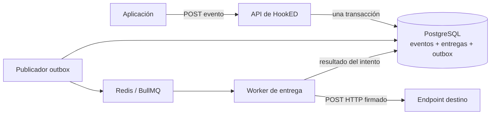

<div align="center">

# HookED

**Entrega confiable de webhooks sin complicaciones.**

[](https://github.com/DevPooks/hooked/actions/workflows/ci.yml)
[](https://nodejs.org/)
[](https://www.typescriptlang.org/)
[](LICENSE)

[English](README.md) · [Español](README.es.md) · [Documentación API](http://localhost:3000/docs)

</div>

HookED es un servicio pequeño y autoalojable que se ocupa de la parte difícil de los webhooks: conseguir que un evento llegue cuando la red está lenta, el receptor falla o el cliente repite una solicitud. Recibe eventos por HTTP, los persiste en PostgreSQL y entrega solicitudes firmadas de forma asíncrona mediante BullMQ.

## Qué demuestra el proyecto

- Separación real entre API y worker
- Outbox transaccional entre PostgreSQL y Redis
- Idempotencia respaldada por restricciones de base de datos
- Reintentos exponenciales, timeout estricto e historial por intento
- Firmas HMAC-SHA256 y controles contra SSRF
- TypeScript estricto, pruebas unitarias/integración, Docker y CI

## Arquitectura



La API confirma el evento, sus entregas y el outbox en una sola transacción. El publicador puede reintentar sin duplicar el trabajo lógico y los reintentos vuelven al outbox durable.

## Inicio rápido

```bash
git clone https://github.com/DevPooks/hooked.git
cd hooked
docker compose up --build
```

- API: `http://localhost:3000`
- Salud: `http://localhost:3000/health`
- Swagger UI: `http://localhost:3000/docs`

## Ejemplo

```bash
# Crear aplicación
curl -sS -X POST http://localhost:3000/api/v1/applications \
  -H 'Content-Type: application/json' \
  -d '{"name":"Checkout"}'

# Enviar evento (reemplaza app_ID)
curl -sS -X POST http://localhost:3000/api/v1/applications/app_ID/events \
  -H 'Content-Type: application/json' \
  -H 'Idempotency-Key: checkout-order-42' \
  -d '{"type":"order.completed","data":{"order_id":"ord_42"}}'
```

La respuesta inicial es `202`; la entrega ocurre en segundo plano.

## Política de entrega

- `2xx`: éxito.
- `408`, `429`, `5xx`, timeout y errores de red: reintento.
- La mayoría de los `4xx`: fallo permanente.
- `3xx`: no se siguen redirecciones.
- Al agotar los intentos, la entrega queda en estado `dead`.

El calendario por defecto es inmediato, 30 segundos, 2 minutos, 10 minutos y 30 minutos. Se configura con `WEBHOOK_RETRY_DELAYS_MS`.

## Idempotencia y replay

Una clave `Idempotency-Key` es única dentro de cada aplicación. Solicitudes concurrentes con la misma clave y el mismo cuerpo devuelven el evento original. Reutilizar la clave con otro cuerpo produce un conflicto `409`.

Una entrega terminada se puede reproducir con `POST /api/v1/deliveries/:id/replay`. El historial anterior se conserva y existe un cooldown configurable para evitar repeticiones accidentales.

## Seguridad

Los endpoints privados, loopback, link-local y de metadata se bloquean por defecto. HookED valida DNS en cada entrega y conecta a la dirección ya validada. También limita el tamaño del payload, aplica timeout, no sigue redirects y no registra secretos ni payloads completos.

La firma usa `HMAC-SHA256(timestamp + "." + raw_body)`. Revisa [docs/security.md](docs/security.md) para el ejemplo de verificación y las limitaciones. En esta versión educativa el secreto se almacena sin cifrar; una instalación de producción debería usar cifrado por envolvente con un KMS.

## Pruebas

```bash
npm test
npm run typecheck
npm run lint
npm run build
RUN_INTEGRATION=true npm run test:integration
```

La integración comprueba idempotencia concurrente, retry tras `500`, firma, historial, replay y estado `dead` con PostgreSQL y Redis reales.

## Limitaciones conocidas

- No incluye autenticación ni aislamiento multi-tenant.
- Los secretos no están cifrados en reposo.
- Aún no hay métricas Prometheus ni panel administrativo.
- El rate limiting de la API queda para una siguiente versión.

## Documentación

- [Arquitectura](docs/architecture.md)
- [Seguridad](docs/security.md)
- [Notas para entrevistas](docs/interview-notes.md)
- [Resumen para CV](docs/cv-summary.md)
- [Cómo contribuir](CONTRIBUTING.md)

## Licencia

[MIT](LICENSE)
