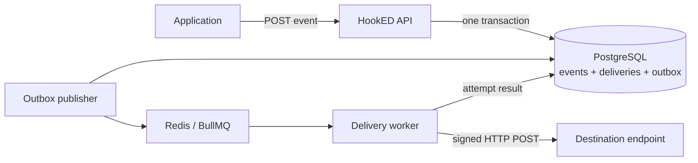

<div align="center">

# HookED

**Reliable webhook delivery without the headache.**

[](https://github.com/DevPooks/hooked/actions/workflows/ci.yml)
[](https://nodejs.org/)
[](https://www.typescriptlang.org/)
[](LICENSE)

[English](README.md) · [Español](README.es.md) · [API docs](http://localhost:3000/docs)

</div>

HookED is a small, self-hostable service for the unglamorous part of webhooks: making sure an event reaches its destination when networks are slow, receivers fail, or callers retry a request. It accepts events through an HTTP API, persists them in PostgreSQL, and delivers signed requests asynchronously through BullMQ.

The design keeps the interesting reliability boundary visible. A transactional outbox bridges PostgreSQL and Redis, each HTTP attempt has a durable record, and retry decisions are explicit rather than hidden behind a framework.

## Why HookED?

A plain `fetch()` is enough until a receiver times out, returns `429`, or goes offline for ten minutes. At that point the sender needs queues, retry policy, duplicate protection, observability, and a way to investigate or replay a failed delivery. HookED packages those concerns into one focused backend service without trying to become a full SaaS platform.

## Features

- Durable asynchronous delivery through PostgreSQL, Redis, and BullMQ
- Transactional outbox for safe database-to-queue publication
- HMAC-SHA256 signatures with a secret returned once at endpoint creation
- Application-scoped idempotency backed by a database uniqueness constraint
- Configurable timeouts, maximum attempts, and retry intervals
- Delivery and attempt history with status, latency, and error category
- Replay for completed deliveries, with cooldown protection
- SSRF controls that reject loopback, private, link-local, and metadata addresses
- Strict payload limits, request IDs, Zod validation, and structured redacted logs
- Interactive OpenAPI documentation at `/docs`
- Docker Compose development environment and a purpose-built test receiver

## Architecture



The API never waits for a destination endpoint. It commits the event, its delivery records, and outbox entries together. The publisher can safely retry queue publication because BullMQ job IDs are derived from outbox IDs. Retry scheduling returns to the same durable outbox instead of relying on process memory.

Read [the architecture notes](docs/architecture.md) for failure scenarios and tradeoffs.

## Stack

| Area | Choice | Purpose |
|---|---|---|
| Runtime | Node.js 24 + TypeScript | Strict, modern server code |
| HTTP | Fastify + Zod | API, validation, structured logging |
| Storage | PostgreSQL 17 | Events, idempotency, state, history, outbox |
| Queue | Redis 7 + BullMQ | Bounded concurrent background delivery |
| Tests | Vitest | Unit and full delivery-flow tests |
| Operations | Docker Compose + GitHub Actions | Reproducible local stack and CI |

## Quick start

Requirements: Docker with Compose.

```bash
git clone https://github.com/DevPooks/hooked.git
cd hooked
docker compose up --build
```

The API listens on `http://localhost:3000`, health is at `/health`, and Swagger UI is at [`/docs`](http://localhost:3000/docs).

For local source development:

```bash
cp .env.example .env
npm install
npm run migrate
npm run dev       # terminal 1
npm run worker    # terminal 2
```

## API example

Create an application:

```bash
curl -sS -X POST http://localhost:3000/api/v1/applications \
  -H 'Content-Type: application/json' \
  -d '{"name":"Checkout"}'
```

Create an endpoint (the response contains its signing secret once):

```bash
curl -sS -X POST http://localhost:3000/api/v1/applications/app_ID/endpoints \
  -H 'Content-Type: application/json' \
  -d '{"url":"https://example.com/webhooks/orders"}'
```

Submit an event safely:

```bash
curl -sS -X POST http://localhost:3000/api/v1/applications/app_ID/events \
  -H 'Content-Type: application/json' \
  -H 'Idempotency-Key: checkout-order-42' \
  -d '{"type":"order.completed","data":{"order_id":"ord_42","amount":12900}}'
```

Other routes cover endpoint listing/deactivation, event lookup, delivery history, and replay. The complete contract is generated at `/docs`.

## Delivery lifecycle

```text
pending → processing → succeeded
                     ↘ failed       (most 4xx responses)
                     ↘ retrying → processing
                                   ↘ dead (retry budget exhausted)
```

A `2xx` response succeeds. `408`, `429`, `5xx`, timeouts, DNS failures, and connection failures are retried. Most other `4xx` responses fail permanently because repeating the same request is unlikely to help. Redirects are not followed; a `3xx` is treated as a permanent HTTP failure.

The default attempts happen immediately, after 30 seconds, 2 minutes, 10 minutes, and 30 minutes. `WEBHOOK_RETRY_DELAYS_MS` makes the schedule explicit and lets tests use millisecond delays.

## Idempotency

`Idempotency-Key` is scoped to an application. Two concurrent submissions with the same key and body return the same event. Reusing the key with a different body returns `409 IDEMPOTENCY_KEY_REUSED`. PostgreSQL enforces the invariant; it is not an in-memory cache that disappears on restart.

## Webhook signatures

Every request includes:

```text
X-HookED-Event-ID: evt_...
X-HookED-Timestamp: 1760000000
X-HookED-Signature: v1=<hex HMAC-SHA256>
```

The signed message is `timestamp + "." + raw_body`. A receiver should reject old timestamps, calculate HMAC-SHA256 with its endpoint secret, and compare signatures in constant time. See [the security guide](docs/security.md#receiver-verification) for working Node.js code.

## SSRF protection

Endpoint URLs must use HTTP or HTTPS and cannot contain embedded credentials. HookED resolves DNS before each delivery, rejects any private or reserved result, then pins the connection to the validated address. This closes the most direct DNS-rebinding gap while keeping the original hostname for TLS verification.

Private endpoints are disabled by default. They can be enabled only for trusted local development with `ALLOW_PRIVATE_ENDPOINTS=true`:

```bash
ALLOW_PRIVATE_ENDPOINTS=true docker compose --profile demo up --build
```

The demo receiver then exposes `/success`, `/flaky`, `/fail-500`, `/rate-limit`, and `/timeout` on port 3100.

## Testing

```bash
npm test              # unit suite
npm run typecheck
npm run lint
npm run build
```

Integration tests require PostgreSQL and Redis and exercise concurrent idempotency, a 500→retry→200 flow, signature verification, attempt history, replay, and dead-letter behavior:

```bash
RUN_INTEGRATION=true npm run test:integration
```

CI starts disposable service containers and runs the complete suite plus a Docker image build.

## Security considerations

- Endpoint secrets and event payloads are redacted from application logs.
- Response bodies are deliberately not stored.
- Event bodies are limited to 256 KB by default.
- Delivery requests have a hard timeout and do not follow redirects.
- The endpoint secret is stored in plaintext in this educational version. Production deployments should encrypt it with a managed key service.
- Authentication, tenant isolation, inbound rate limiting, and secret rotation are outside the first release.

See [docs/security.md](docs/security.md) and [SECURITY.md](SECURITY.md).

## Known limitations

- This is a single-tenant reference service; the API has no authentication yet.
- Endpoint secrets are not encrypted at rest.
- Replay cooldown is local policy, not a complete abuse-control system.
- A worker crash after claiming a job consumes an attempt; a recovery loop returns stale work to the queue, but the interrupted HTTP call has no completed attempt row.
- Queue metrics and a dead-letter dashboard are not included.

## Roadmap

- API authentication and application-scoped credentials
- Envelope encryption and secret rotation
- Prometheus metrics and queue-depth alerts
- Endpoint rate limits and per-tenant concurrency
- Delivery filtering by event type
- Pagination for event and delivery history

## Project notes

- [Architecture](docs/architecture.md)
- [Security](docs/security.md)
- [Interview notes](docs/interview-notes.md)
- [CV summary](docs/cv-summary.md)
- [Contributing](CONTRIBUTING.md)

## License

[MIT](LICENSE)
